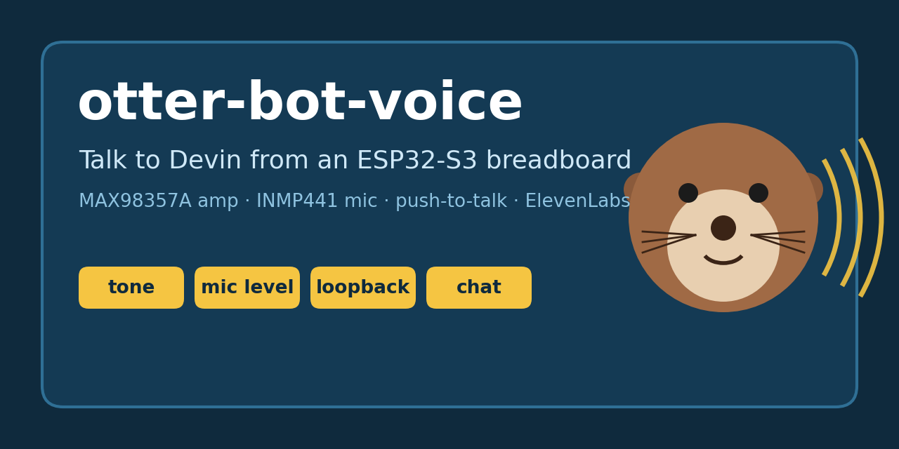
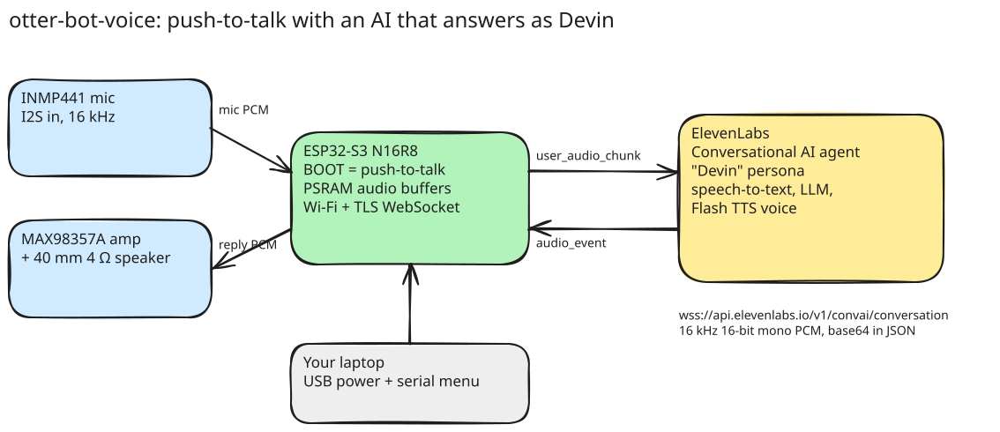
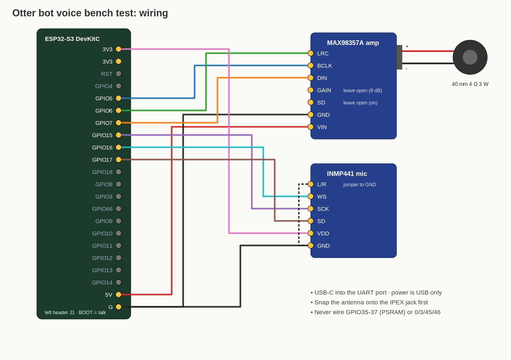

# otter-bot-voice



ESP32-S3 talking otter robot, step 1: a breadboard bench test that checks an I2S amp, speaker
and mic, then holds a push-to-talk voice conversation with an AI that answers as Devin
(ElevenLabs Conversational AI over Wi-Fi).

**Tags:** `esp32-s3` `arduino` `i2s` `max98357a` `inmp441` `elevenlabs` `conversational-ai` `voice-assistant` `robotics` `push-to-talk`

## Architecture



Source: [docs/architecture.excalidraw](docs/architecture.excalidraw) (open it at excalidraw.com).

The ESP32 records 16 kHz mono PCM from the INMP441 while BOOT is held and streams it as
`user_audio_chunk` messages over a TLS WebSocket to the ElevenLabs agent. When BOOT is released it
streams silence, which lets the agent detect the end of your turn. The agent's spoken reply comes back
as base64 PCM, gets buffered in PSRAM and plays through the MAX98357A. A live Devin session is not in
the loop: a session takes tens of seconds to reply, so the agent plays Devin instead.

## Parts

| Part | What arrived | Notes |
| --- | --- | --- |
| Board | FORIOT ESP32-S3 N16R8 DevKitC (headers soldered) | Snap the antenna on |
| Amp | SATUY MAX98357A I2S 3 W class-D breakout | Solder the header strip |
| Mic | INMP441 I2S MEMS mic module | Solder the header strip |
| Speaker | Gikfun 40 mm 4 Ω 3 W (EK1794) | Goes in the amp's screw terminal |
| Misc | Half-size breadboard, ~12 jumpers, USB-C cable | USB power only |

## Pin map

| ESP32-S3 (left header J1) | MAX98357A | INMP441 |
| --- | --- | --- |
| 5V | VIN | |
| 3V3 | | VDD |
| G | GND | GND, L/R |
| GPIO5 | BCLK | |
| GPIO6 | LRC | |
| GPIO7 | DIN | |
| GPIO15 | | SCK |
| GPIO16 | | WS |
| GPIO17 | | SD |
| BOOT button (GPIO0) | push-to-talk | |

Leave the amp's GAIN and SD pins unconnected (9 dB gain, amp on). Never wire the mic to 5V.



## Run it

Step-by-step bench test, including soldering, flashing and troubleshooting:
**[docs/bench-test.md](docs/bench-test.md)**.

Short version: copy `firmware/otter_voice/secrets.example.h` to `secrets.h`, fill in your
2.4 GHz Wi-Fi and the agent ID, flash with Arduino IDE (board "ESP32S3 Dev Module", PSRAM "OPI PSRAM",
flash 16 MB), open the Serial Monitor at 115200, then press `t`, `m`, `l` and `c` in turn.

## Accounts and keys

| What | Where it goes | Notes |
| --- | --- | --- |
| ElevenLabs account (Creator plan or higher) | ElevenLabs dashboard | Conversational AI minutes come from the plan |
| ElevenLabs agent ID | `secrets.h` | Not the API key: the board never holds your API key |
| 2.4 GHz Wi-Fi name and password | `secrets.h` | Gitignored, stays on your laptop |

`agent/` has the agent config and how to recreate it. `tools/agent_smoke_test.py` talks to the agent
exactly like the firmware does, from a laptop, without any hardware.

## Repo layout

```
firmware/otter_voice/   Arduino sketch (compiled on ESP32 Arduino core 4.0.0, ArduinoJson 7)
agent/                  ElevenLabs agent config
docs/                   bench test guide, wiring and architecture diagrams
tools/                  agent smoke test and diagram generators
```
