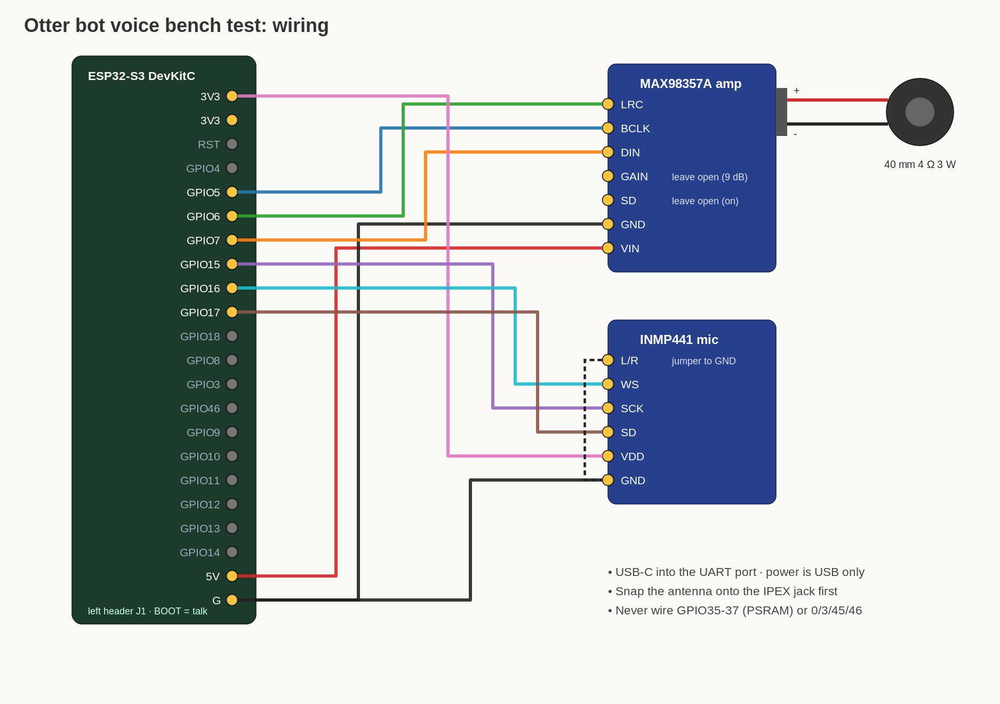

# Bench test: speaker, mic, then a conversation with Devin

About 60 to 90 minutes the first time, most of it soldering. Power comes from USB only. Servos come later.

## 0. What you need

- Everything in the [parts table](../README.md#parts), plus the Pinecil, solder, flush cutters
  and the header strips that came in the amp and mic bags.
- A laptop with [Arduino IDE 2](https://www.arduino.cc/en/software) and a USB-C data cable.
- Your 2.4 GHz Wi-Fi name and password (the ESP32-S3 can't join 5 GHz).
- The ElevenLabs agent ID, which Maker posts in the Slack thread. It's also in ElevenLabs > Agents >
  "Devin (otter bot bench test)".

## 1. Solder the headers (about 30 min)

Follow the [First Soldering Session Guide](https://docs.google.com/document/d/1tdPMQEAPjI0QWa7ej5oEV0HyoV3aXKeF2Xji-4P-hq8/edit).

1. Push a header strip, long pins down, into the breadboard, and drop the board on top so the pins
   poke up through its holes. The breadboard holds everything straight while you solder.
2. Solder the INMP441 (6 pins) with the mic hole facing up, away from the breadboard.
3. Solder the MAX98357A's 7-pin row (LRC, BCLK, DIN, GAIN, SD, GND, VIN). If the speaker screw
   terminal came loose in the bag, solder it on too, with its openings facing outward.
4. Check every joint is a shiny little cone and no two neighbouring pins are bridged.

## 2. Wire the breadboard (about 15 min, USB unplugged)



1. If your board has an IPEX antenna jack (a tiny gold socket by the module), snap the Wi-Fi antenna onto it.
2. Straddle the ESP32 across the breadboard's centre gap. The amp and mic have a single row of
   pins, so they can't straddle: lay each header along a row on the other half, so every pin sits
   in its own 5-hole strip and no two pins share a strip.
3. Wire the [pin map](../README.md#pin-map). Use the labels printed on your board's silkscreen,
   not header positions, because clone boards sometimes reorder pins.
4. Add one short jumper from the mic's L/R pin to GND.
5. Speaker: red wire into the amp's `+` terminal, black into `-`, and tighten the screws.
6. Double-check two things before you power up. The mic's VDD goes to **3V3**, never 5V. Nothing
   connects to GPIO35, 36 or 37.

## 3. Flash the firmware (about 10 min)

1. Arduino IDE > Boards Manager: install **esp32 by Espressif Systems** (tested with 4.0.0).
2. Library Manager: install **ArduinoJson** by Benoit Blanchon (v7).
3. Open `firmware/otter_voice/otter_voice.ino`.
4. Copy `secrets.example.h` to `secrets.h` in the same folder and fill in the Wi-Fi name, the
   password and the agent ID. `secrets.h` is gitignored.
5. Tools menu:
   - Board: **ESP32S3 Dev Module**
   - Flash Size: **16MB (128Mb)**
   - PSRAM: **OPI PSRAM**
   - Partition Scheme: **16M Flash (3MB APP/9.9MB FATFS)**
   - USB CDC On Boot: **Disabled**
6. Plug the USB-C cable into the port labelled **UART** (some boards say COM), pick its port and
   click Upload. If the upload never starts, hold BOOT, tap RST, release BOOT, then try again.
7. Open Serial Monitor at **115200** baud. You should see the menu.

Same thing from a terminal (`arduino-cli board list` shows the port name to use):

```bash
arduino-cli compile --upload -p /dev/cu.usbserial-XXXX \
  -b "esp32:esp32:esp32s3:PSRAM=opi,FlashSize=16M,PartitionScheme=app3M_fat9M_16MB" firmware/otter_voice
arduino-cli monitor -p /dev/cu.usbserial-XXXX -c baudrate=115200
```

## 4. Hardware checks

Type a letter in the Serial Monitor's input box and press Enter.

| Key | Test | Pass |
| --- | --- | --- |
| `t` | Tone | Three rising beeps from the speaker |
| `m` | Mic level, 10 s | Quiet room below about -60 dBFS; talking at arm's length -35 to -20; a clap spikes the bar |
| `l` | Loopback | Hold BOOT, talk for up to 5 s, release, and you hear yourself |

`+`/`-` change the volume, and `]`/`[` make the mic louder or quieter. The board prints
`Mic found on the left slot` the first time it hears the mic.

## 5. Talk to Devin

1. Press `c`, or just press BOOT at the menu.
2. The board joins Wi-Fi, connects, and Devin greets you.
3. Hold BOOT, say something, and let go. The LED is green while you talk. About 3 to 5 s
   after you let go, Devin answers, and the serial monitor shows both sides as text.
4. To interrupt Devin, press BOOT again. Press `q` to hang up. Calls end on their own after 5 minutes.

## Troubleshooting

| Symptom | Fix |
| --- | --- |
| No beeps | Amp VIN is on 5V (not 3V3), GND is shared, BCLK/LRC/DIN aren't swapped, and the speaker screws are tight |
| Distorted or very loud tone | Press `-` a few times |
| Mic meter stuck near -120 dBFS | SCK/WS swapped, SD not on GPIO17, or the mic is on 5V (a 5V mic may be dead) |
| Board resets while Devin talks | The USB port can't supply enough current. Use a powered hub or wall charger, or turn the volume down |
| `WARNING: no PSRAM` | Tools > PSRAM > OPI PSRAM, then reflash |
| Wi-Fi failed | 2.4 GHz network, antenna on, and the SSID typed exactly |
| `Server closed the conversation (code 3000 The AI agent ... does not exist.)` | Wrong agent ID in `secrets.h`: copy it again from the Slack thread or ElevenLabs > Agents |
| Calls stop connecting after a busy day | The agent's daily call cap (100) is used up; it resets the next day |
| LED never lights | Your board is a v1.1 with the RGB LED on GPIO38: set `STATUS_LED = 38` in `otter_voice.ino` and reflash. Everything else works without the LED |
| Devin talks over itself or hears itself | Only hold BOOT while you speak: the mic is muted otherwise |

## Test the agent without hardware

```bash
pip install websockets
python3 tools/agent_smoke_test.py --agent-id agent_xxx --pcm question.pcm   # 16 kHz 16-bit mono raw PCM
```
